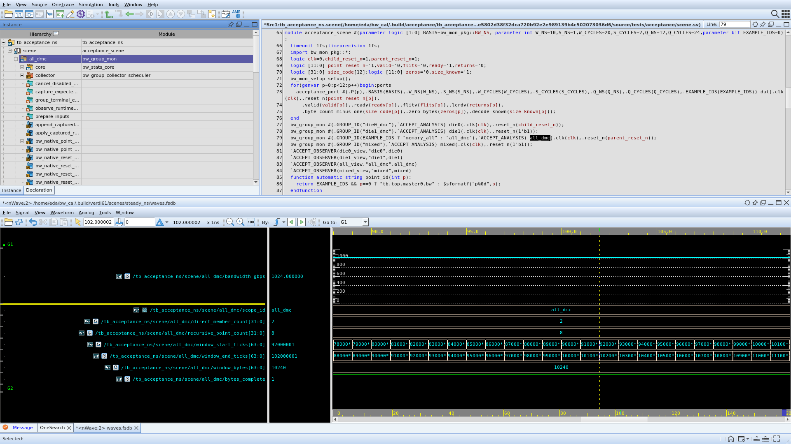
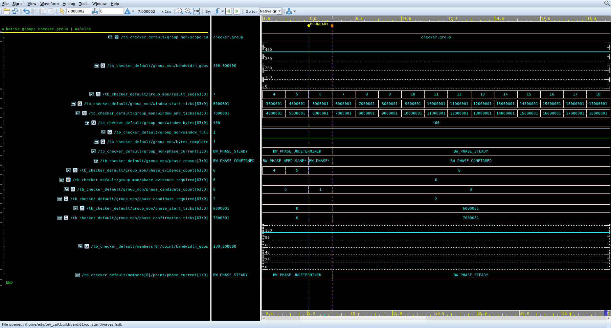
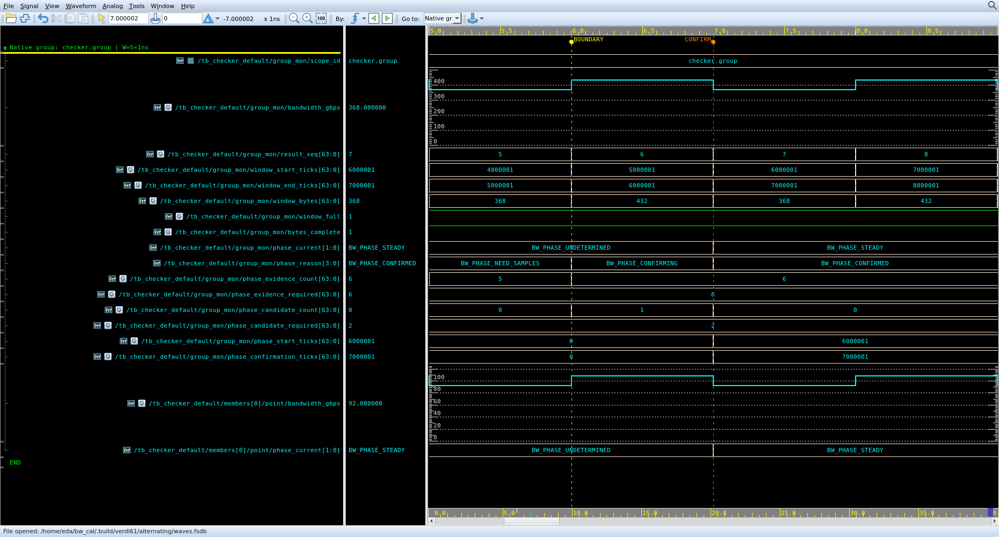
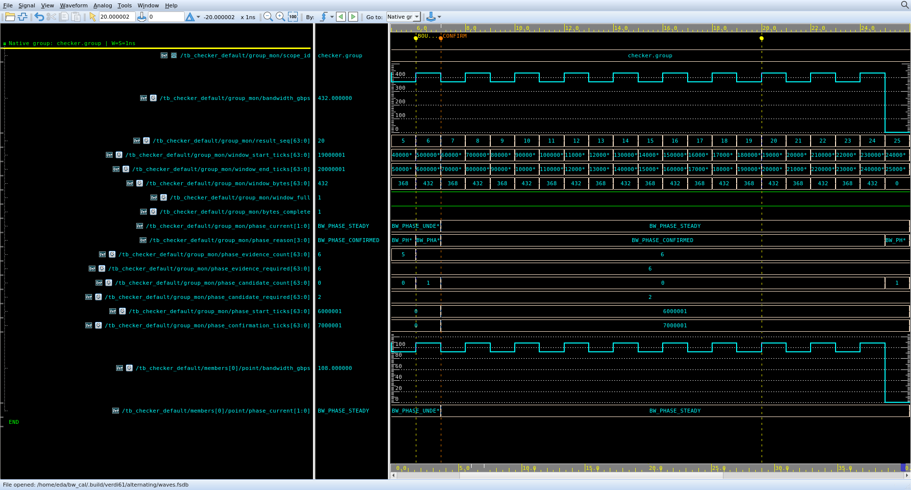

# 新产品 Verdi 聚焦人工验收

[真实 Verdi 截图与聚焦人工验收](https://github.com/MakeReadUnique/bw_mon/issues/61)
的四个新视图。**自动核验通过；实际用户反馈待完成，工单保持开放。**
[逐文件哈希、源码适用性与人工记录](review.json)分别保存，旧九图签认不覆盖这些资产。

运行产品来源为 `eadec744516a125cca3441f29a27420b66285b6b`；RTL 未改。
十二点/四组场景沿用公开接入和独立原始输入；两个 checker 场景沿用
`tests/tb_checker_default.sv` 与 `tests/checker_default/check.py`，仅 bind
[FSDB dump](../../tests/verdi61/dump.sv)，不修改流量或预设阶段归属。
VCS W-2024.09、Verdi W-2024.09-SP1；图为原生 Verdi 截图，无信号重命名和图像编辑。

本次共同起点 **T=1 fs=0.000001 ns**。横轴为绝对 ns，所有 `*_ticks` 的单位为 fs。
光标放在发布后 1 fs。下表区间中的 `T+` 不能省略。

| 视图／对象／查看区间 | 独立预期 | 实际／差异 |
| --- | --- | --- |
| `named_group`：`tb_acceptance_ns.scene.all_dmc`，88–112 ns，光标 102.000002 ns | 源码第79行真实 `all_dmc` 实例；Group ID=`all_dmc`；直接成员2、递归点8；窗口 `[T+92,T+102)`；10240 B/10 ns=1024 GB/s | 全部一致；数值差0 |
| `default_phase`：`tb_checker_default.group_mon`／`checker.group`，4–19 ns，光标7.000002 ns | 阶段边界 `T+6`，确认 `T+7`；已有／所需证据6/6、候选要求2；组400、点100 GB/s；最终默认检查PASS | 全部一致；5个点/组结果PASS，差0 |
| `sustained_boundary`：同组，5–9 ns，光标7.000002 ns | 冻结参考B=400，5%=20；seq6的432与seq7的368分别偏离+8%/−8%；两条新观测跨度1 ns=W，达到持续条件 | 432→368；满窗、字节完整；差0。参考建立后回查这两条，不表示在7 ns已经输出最终FAIL |
| `steady_fail`：同组及`members[0].point`，5–26 ns，光标20.000002 ns | 阶段保持STEADY，组432、点108 GB/s；最终检查FAIL；完整超限段seq6–24共19条，跨度18 ns | 全部一致；5个点/组结果FAIL，差0；后续观察继续 |

两个 checker 场景均开启过程、省略阶段算法参数，W=1 ns，省略S后取W、省略Q后取10 ns，
没有性能预期文件。组的六个参考窗口为seq7–12，B=400；
最终原始字节/稳定段时长所得带宽为389.18918918918916 GB/s，和参考带宽是不同量。
十二点层级场景明确使用W/S/Q=10/1/12 ns。









## 追溯和打开

原始FSDB、输入、编译源码快照、日志、独立参考、保存视图和GUI操作记录保存在
`review.json` 的 `asset_commit` 所指固定提交的 `artifacts/verdi61-data/`。
当前文件列表只保留截图、摘要和工具。恢复不会重新仿真：

```bash
python3 tests/verdi61/verify.py
git archive "$(python3 -c 'import json; print(json.load(open("evidence/verdi61/review.json"))["asset_commit"])')" artifacts/verdi61-data | tar -x
python3 tests/verdi61/open.py named_group --source
python3 tests/verdi61/open.py default_phase
python3 tests/verdi61/open.py sustained_boundary
python3 tests/verdi61/open.py steady_fail
```

每条 `open.py` 打开一个视图，结束后再开下一条。`--source` 使用保存的真实源码重新导入Verdi，
不依赖原构建目录。已实际验证十二点场景的源码重开，编译器0错误/0警告。
在层级树双击 `tb_acceptance_ns.scene.all_dmc`，Signal List筛选 `bandwidth`，
把 `bandwidth_gbps` 拖到nWave，即得到截图中的原生完整路径。
该操作本轮由agent通过X11鼠标执行并留有原始事件记录，不计作用户反馈。

重新生成数据和截图（需VCS/Verdi许可；截图display须独占）：

```bash
python3 tests/acceptance/run.py --scene steady --basis ns --output-root .build/verdi61/scenes
python3 tests/verdi61/prepare.py
python3 tests/verdi61/capture.py default_phase --display :88
python3 tests/verdi61/capture.py sustained_boundary --display :88
python3 tests/verdi61/capture.py steady_fail --display :88
```

## 用户反馈

请在关联issue按实际查看范围记录：**视图名、区间、符合预期／差异／无法判断**。
四个视图可分批反馈；没有反馈的行继续待完成。发现差异时附信号和预期/实见值。
记录必须关联本次资产提交和图片哈希；后续源码或资产改变时，先运行适用性核验，
更新受影响视图并取得对应的新反馈。自动PASS、agent看图、截图上传均不能代替人工确认。

本票不创建PR，也不宣告父规格完成；最终唯一PR仍须核对最终源码适用性和其余自动验收。
